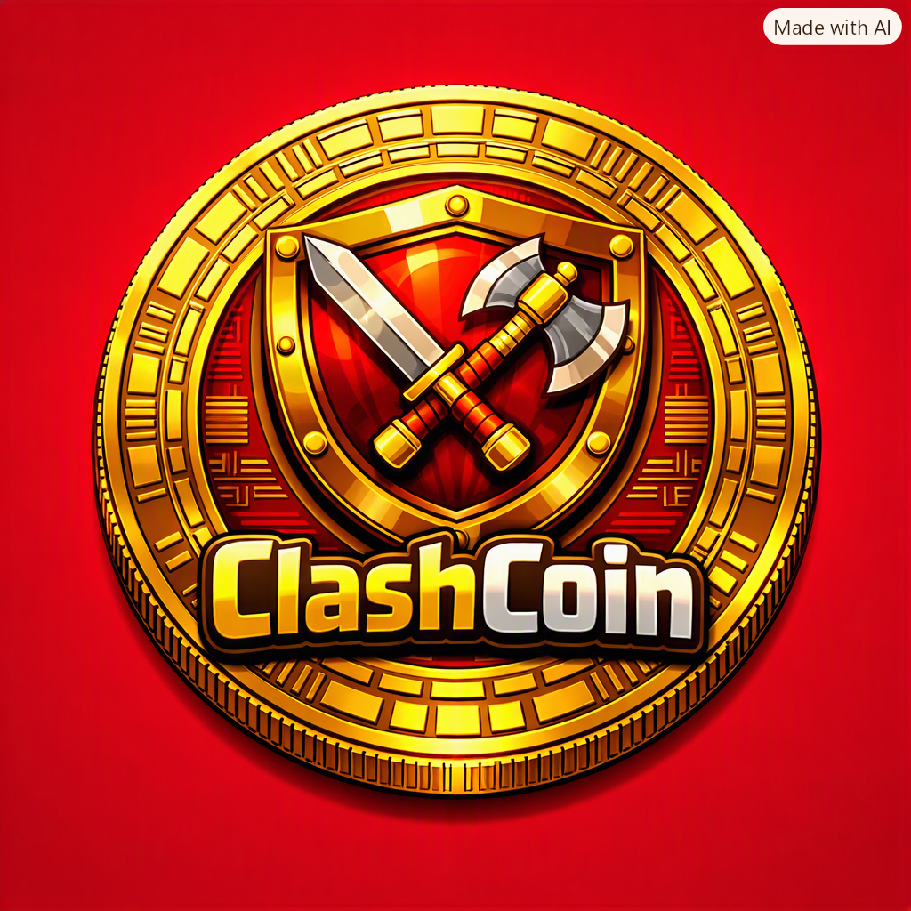

 

# ClashCoin (CCN) Whitepaper

**Ali Alhubaishi / Kakashi**  
Founder & Developer of ClashCoin Project  

---

## 📖 Introduction
ClashCoin is an innovative digital currency inspired by the gaming world.  
It aims to merge the gaming experience with a real digital economy.  
The project seeks to achieve balance between players and investors through a fair and sustainable reward system based on the **Halving** principle — reducing inflation and increasing value over time.

---

## 🎮 Concept
ClashCoin connects real financial value inside and outside the gaming world.  
It provides a complete ecosystem linking in‑game rewards and daily activities with the ability to trade on global platforms.

---

## 💰 Tokenomics
- Total Supply: **15 million coins**
- Distribution:
  - Players & Rewards: **30% (9 million)**
  - Developers & Team: **10% (1.5 million)**
  - Public Sale: **30% (4.5 million)**
  - Reserve & Future Development: **30% (4.5 million)**

---

## ⚙️ Mechanism
Each reward cycle follows the **Halving** model every 850 days.  
This ensures long‑term stability and gradual value growth.

---

## 🔗 Blockchain
ClashCoin operates on **BEP‑20 (Binance Smart Chain)**.  
It supports smart contracts and NFT integration for exclusive in‑game assets.

---

## 🗓️ Roadmap
- **2027 Q1:** Official launch and initial reward distribution.  
- **2027 Q2:** Listing on **OKX** and **PancakeSwap** exchanges.  
- **2027 Q3:** Launch of premium membership **Gold Pass**.  
- **2027 Q4:** NFT marketplace release for ClashCoin ecosystem.

---

## 👨‍💻 Author
**Ali Alhubaishi / Kakashi**  
Game designer and developer.  
Founder of ClashCoin and creator of the Clash gaming ecosystem.

---

## ⚖️ License
This project is released under the **MIT License**.  
Feel free to use, modify, and distribute with proper attribution.

---
